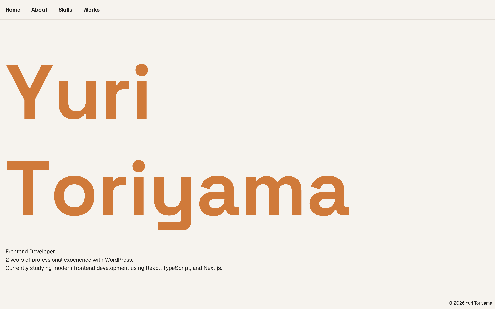
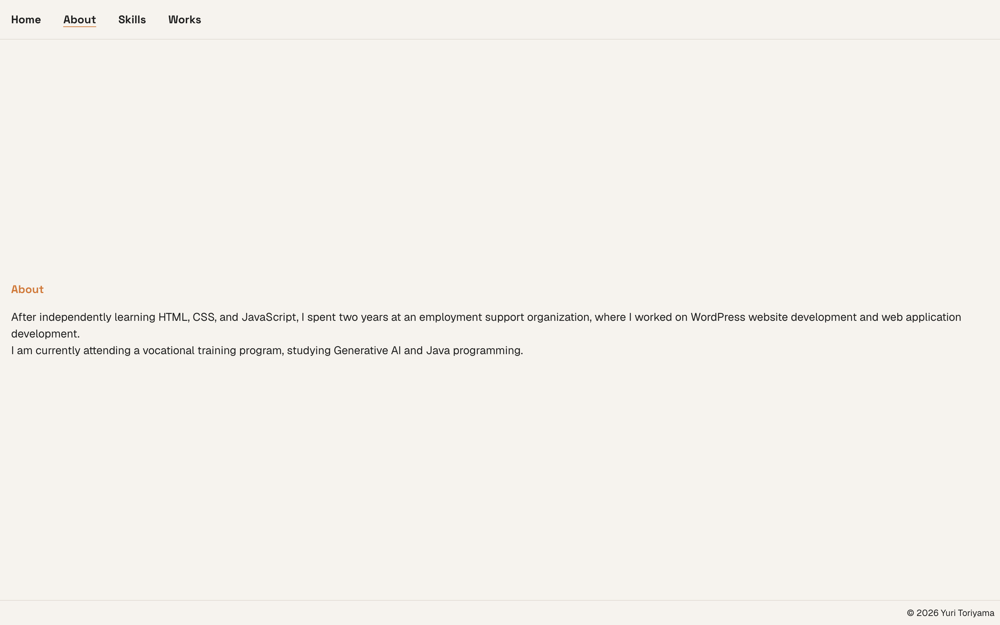
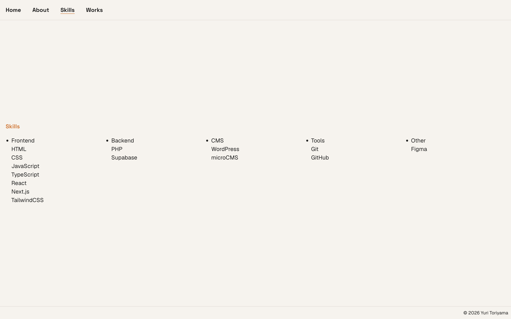
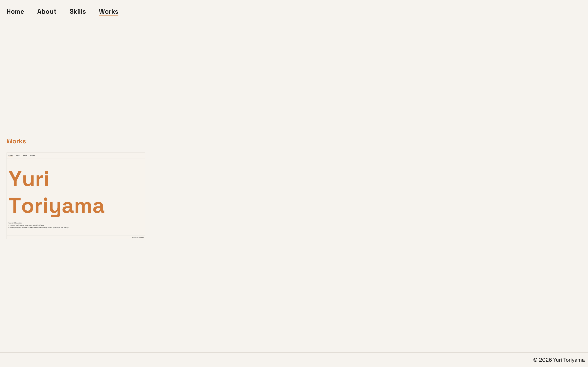
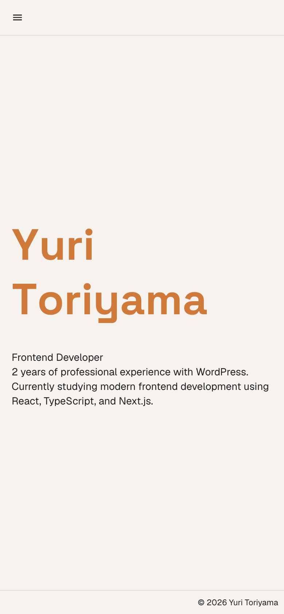

# Portfolio

私の制作した作品を紹介するポートフォリオサイトです。

## Demo

https://portfolio.tw08iwckpyvz48pfu0sx-262.workers.dev/

## Screenshots

### Home



### About



### Skills



### Works



### Mobile



## Features

- 作品一覧の表示
- 作品詳細をモーダルで表示
- レスポンシブ対応
- ダークモード対応
- 文字アニメーションなどのインタラクティブなUI

## Key Implementations

### Parallel Routes & Intercepting Routes

作品詳細はNext.jsのParallel RoutesとIntercepting Routesを利用して実装しています。

一覧画面から遷移した場合はモーダルとして表示
URLへ直接アクセスした場合は通常ページとして表示

これにより、UXとURL共有のしやすさを両立しています。

## Tech Stack

| Category  | Technology   |
| --------- | ------------ |
| Framework | Next.js      |
| Language  | TypeScript   |
| Styling   | Tailwind CSS |
| Lint      | ESLint       |
| Formatter | Prettier     |

### Centralized Configuration

サイト名やメタデータなどの共通情報は`constants`に集約しています。

変更箇所を一元化することで、保守性を向上させています。

### Accessibility

アクセシビリティを意識して実装しています。

- コントラスト比を考慮した配色
- セマンティックなHTML

### UI / Animation

ユーザー体験を向上させるため、過度にならない範囲でアニメーションを採用しています。

- Heroセクションの文字アニメーション
- スムーズなページ遷移

## Getting Started

### Clone the repository

```bash
git clone https://github.com/iotgsdh/portfolio.git
cd portfolio
```

### Install dependencies

```bash
npm install
```

### Run the development server

```bash
npm run dev
```

Open http://localhost:3000 in your browser.

## Directory Structure

```text
.
├── app
│   ├── about
│   ├── skills
│   └── works
├── components
├── constants
└── hooks
```

| Directory    | Description                                                                                                        |
| ------------ | ------------------------------------------------------------------------------------------------------------------ |
| `app`        | App Routerのページ、レイアウト、ルーティングを管理します。`about`、`skills`、`works`などのページを配置しています。 |
| `components` | 再利用可能なUIコンポーネントを配置します。                                                                         |
| `constants`  | サイト情報や共通で使用する定数を管理します。                                                                       |
| `hooks`      | カスタムフックを配置します。                                                                                       |
